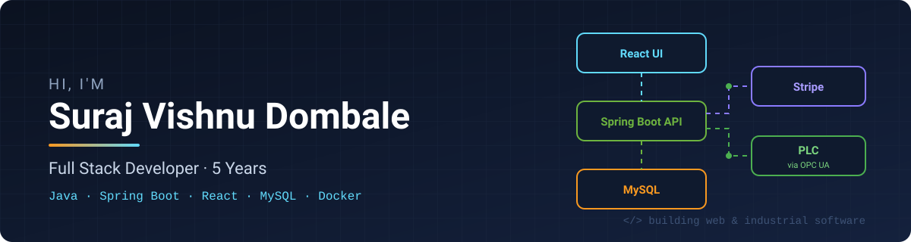

  

  

---

## 🧑‍💻 About Me

I'm a full stack developer from **Pune, India 🇮🇳** with **5 years of experience** building production web applications end to end, from REST APIs and database design to React dashboards and embeddable widgets.

I enjoy working on **SaaS products, payment integrations, and developer-facing features**. With an **Electrical engineering** background, I also build software that talks to industrial hardware. Lately I've been building faster with **AI-assisted development (Claude)** while keeping a focus on clean, maintainable code.

> 🔍 *Currently: open to new full stack opportunities*

---

## 🛠️ Tech Stack

  

**Also working with**

-D97757?style=flat-square&logo=anthropic&logoColor=white)

---

## 🚀 Featured Work

| Project | What it does | Tech | Links |
|---|---|---|---|
| 🚀 **Referral Rocket** | Referral & affiliate platform for SaaS and B2C companies, their affiliates and influencers. Built automated tax calculation for payouts, API rate limiting, embeddable widgets that partners host on their own sites, and the Stripe Marketplace app. *(Professional work, 1.5 years · code is private)* | Java · Spring Boot · React · MySQL · Docker · Stripe |   |
| 📒 **Stripe Bookkeeper** | Stripe reconciliation and bookkeeping. Listens to Stripe webhook events, maintains books for connected Stripe accounts, and exports data in formats accounting software can import. Stripe App coming soon. *(Professional work · code is private)* | Java · Stripe API · MySQL |  |
| 🏭 **SmartBatch360** | Industrial batching plant management system, built for my college's Electrical department lab. Students use it to run and monitor a PLC-controlled concrete batching setup. Includes a live dashboard, production runs, recipe management, and client / site / vehicle / driver management. Communicates with the PLC through an OPC UA server. | Java · Spring Boot · JavaFX · OPC UA · Maven |  |
| 🌐 **Portfolio Website** | My personal profile site with projects and experience | GitHub Pages |  |
| 🧩 **LeetCode** | Daily DSA practice in Java | Java |  |

---

## 📊 GitHub Stats

  
  

  

---

## 🤝 Let's Connect

Open to **Full Stack Developer** roles (Java · Spring Boot · React). Feel free to reach out on [LinkedIn](https://www.linkedin.com/in/suraj-dombale/) or by [email](mailto:surajdombale@gmail.com).
